# MongoDB 完整物理 ERD v2.2

> v2.3 实现补充：MongoDB 可选，公共数据支持在线回退。company_snapshots.snapshot_kind 新增 provider_response；payload 保存精确 request_key、类型化响应及 expires_at（读取时判断过期，不删除历史）。关联索引见 mongodb-schema.json。LangGraph 的内部 checkpoint/writes 使用独立集合，不混入市场证据集合。服务端物理验证仍待验收。

设计稿，2026-10-24。覆盖全部 13 个 MongoDB 集合与全部字段；SQL_USERS 仅表示现有 SQL 账户，不新建同名 Mongo 集合。未执行建库。

## 图例与约束含义

- R：必填；O：可省略，省略不等于 null。
- PK：普通集合 `_id:ObjectId`，MongoDB 自动唯一索引。
- UK1/UK2：该集合内命名业务唯一键。多个字段带同一 UKn 时，**整组字段唯一，不是每个字段分别唯一**。
- partial UK：只约束索引过滤条件命中的文档。图上的 UK 标记必须结合下方条件解释。
- FK：应用层引用，MongoDB 不强制外键，不自动级联。数组引用与 manifest 多态引用也由应用验证。
- `||` 恰好一，`|o` 零或一，`o{` 零或多。数据源到 dataset 的多对多线是 manifest 的逻辑关联，不是额外 join collection。
- 旧迁移报告可以没有 run/dataset；新 native 报告必须都有，不能因 ERD 为兼容画为可选而放宽新写入。
- `reports.run_id` 是生成者，`analysis_runs.cached_from_report_id` 是复用来源，两个关系不能混淆。

## 全字段 ERD

```mermaid
erDiagram
    SQL_USERS ||--o{ DATASETS : owns
    SQL_USERS ||--o{ ANALYSIS_RUNS : owns
    SQL_USERS ||--o{ REPORTS : owns
    SQL_USERS ||--o{ LLM_CACHE : scopes
    INSTRUMENTS ||--o{ PRICE_BARS : has_versions
    INSTRUMENTS }o--o{ NEWS_ARTICLES : mentioned_by
    INSTRUMENTS ||--o{ FINANCIAL_STATEMENTS : discloses
    INSTRUMENTS ||--o{ COMPANY_SNAPSHOTS : observed_as
    INSTRUMENTS ||--o{ CORPORATE_EVENTS : has_events
    INSTRUMENTS ||--o{ DATA_SYNC_JOBS : synchronized_by
    INSTRUMENTS ||--o{ DATASETS : primary_subject
    INSTRUMENTS ||--o{ ANALYSIS_RUNS : analyzes
    INSTRUMENTS ||--o{ REPORTS : reported_on
    DATASETS |o--o{ ANALYSIS_RUNS : bound_after_data_ready
    ANALYSIS_RUNS |o--o| REPORTS : produces
    DATASETS |o--o{ REPORTS : supplies_native_evidence
    ANALYSIS_RUNS ||--o{ LLM_CACHE : original_producer
    REPORTS |o--o{ ANALYSIS_RUNS : reused_by
    PRICE_BARS }o--o{ DATASETS : fixed_version_refs
    NEWS_ARTICLES }o--o{ DATASETS : fixed_version_refs
    FINANCIAL_STATEMENTS }o--o{ DATASETS : fixed_version_refs
    COMPANY_SNAPSHOTS }o--o{ DATASETS : fixed_version_refs
    CORPORATE_EVENTS }o--o{ DATASETS : fixed_version_refs
    SQL_USERS ||--o{ SCAN_RUNS : owns
    SCAN_RUNS ||--o{ SCAN_RESULTS : persists_all_outcomes
    INSTRUMENTS ||--o{ SCAN_RESULTS : scanned_as
    DATASETS |o--o{ SCAN_RESULTS : evidence
    SCAN_RESULTS |o--o{ ANALYSIS_RUNS : triggers_analysis
    SQL_USERS {
        string id PK "existing SQL entity"
    }
    INSTRUMENTS {
        objectId _id PK "R; PK；MongoDB 自动唯一索引"
        int schema_version "R; 文档 schema 版本"
        string market "R; UK1 partial; 市场，如 US/CN"
        string exchange "R; UK1 partial; 交易所 MIC；不使用任意展示名"
        string symbol "R; UK1 partial; 规范代码，不充当永久主键"
        string name "R; 名称"
        string asset_type "R; 资产类型"
        string currency "R; ISO 4217 币种"
        string timezone "R; IANA 时区"
        object provider_symbols "R; yahoo/finnhub 的代码映射"
        array symbol_history "O; 曾用代码及其有效范围"
        bool active "R; 是否仍有效"
        date created_at "R; UTC 创建时间"
    }
    PRICE_BARS {
        objectId _id PK "R; PK；MongoDB 自动唯一索引"
        int schema_version "R; 文档 schema 版本"
        objectId instrument_id FK "R; UK1; FK instruments._id"
        string source "R; UK1; 来源"
        string interval "R; UK1; 第一阶段仅日线"
        string session_date "R; UK1; 交易所本地 YYYY-MM-DD"
        date bar_time "R; 该交易 session 开盘时间转 UTC"
        int revision "R; UK1; 同一逻辑 bar 的版本，从 1 开始"
        decimal open "R; 原始开盘价"
        decimal high "R; 原始最高价"
        decimal low "R; 原始最低价"
        decimal close "R; 原始收盘价"
        long volume "R; 成交量"
        decimal adjusted_close "O; 供应商复权收盘价；缺失则省略"
        decimal dividend "O; 每股分红"
        decimal split_ratio "O; 拆股比例"
        string adjustment_policy "R; 原始价格及复权计算策略版本"
        string content_hash "R; 规范化内容 SHA256"
        date fetched_at "R; 本次抓取时间"
        date first_seen_at "R; 系统第一次见到该版本的时间"
    }
    NEWS_ARTICLES {
        objectId _id PK "R; PK；MongoDB 自动唯一索引"
        int schema_version "R; 文档 schema 版本"
        string article_key "R; UK1; 稳定逻辑文章键：SHA256(provider+provider_article_id)，缺 ID 时用规范 URL"
        int revision "R; UK1; 内容修订版本"
        string provider "R; API 数据来源，如 finnhub"
        string provider_article_id "O; 供应商 article id，统一字符串"
        string canonical_url "R; 规范化原文 URL"
        string publisher "R; 新闻原发布方"
        string headline "R; 标题"
        string summary "R; 供应商允许保存的摘要"
        string language "R; BCP47 语言代码"
        array instrument_ids FK "R; FK instruments._id；去重数组"
        date published_at "R; 供应商给出的发布时间"
        date first_seen_at "R; 本系统首次见到此版本"
        date fetched_at "R; 抓取时间"
        string content_hash "R; 标题/摘要等规范内容 hash"
        string content_policy "R; 保存范围"
        objectId fulltext_file_id FK "O; 有授权时的 GridFS 全文引用"
        object quality "O; 时间缺失、来源异常、覆盖范围提示"
    }
    FINANCIAL_STATEMENTS {
        objectId _id PK "R; PK；MongoDB 自动唯一索引"
        int schema_version "R; 文档 schema 版本"
        objectId instrument_id FK "R; UK1; FK instruments._id"
        string source "R; UK1; 来源供应商"
        string period_type "R; 财报周期"
        date period_end "R; 报告期结束日"
        string filing_key "R; UK1; 来源 filing id；无 ID 时用稳定的报告期/文件标识"
        int revision "R; UK1; 同一 filing 重述版本"
        date published_at "O; 真实披露时间；未知则省略"
        date first_seen_at "R; 本系统首次获知版本"
        string currency "R; 财报币种"
        object income_statement "R; 标准字段映射后的利润表，金额 Decimal128"
        object balance_sheet "R; 标准资产负债表，金额 Decimal128"
        object cash_flow "R; 标准现金流表，金额 Decimal128"
        string source_url "O; 披露/来源链接"
        string content_hash "R; 规范内容 SHA256"
        string pit_status "R; 时点可得性"
    }
    COMPANY_SNAPSHOTS {
        objectId _id PK "R; PK；MongoDB 自动唯一索引"
        int schema_version "R; 文档 schema 版本"
        objectId instrument_id FK "R; UK1; FK instruments._id"
        string source "R; UK1; 来源"
        string snapshot_kind "R; UK1; 快照类型"
        date observed_at "R; UK1; 实际抓取观察时间"
        date effective_at "O; 来源声明的有效时间，无则省略"
        object payload "R; 按 snapshot_kind 校验的快照字段"
        string content_hash "R; 规范内容 SHA256"
        string currency "O; 货币字段的币种"
    }
    CORPORATE_EVENTS {
        objectId _id PK "R; PK；MongoDB 自动唯一索引"
        int schema_version "R; 文档 schema 版本"
        objectId instrument_id FK "R; UK1; FK instruments._id"
        string source "R; UK1; 来源"
        string event_key "R; UK1; 供应商事件 ID 或类型定义的稳定自然键"
        string event_type "R; UK1; 事件类型"
        int revision "R; UK1; 更新/取消版本"
        date event_at "R; 事件发生时间或计划发生时间"
        date published_at "O; 该事件信息首次发布的时间，未知省略"
        date first_seen_at "R; 本系统首次看到该版本"
        string status "R; 状态"
        object payload "R; 按事件类型定义的业务字段"
        string content_hash "R; 规范内容 SHA256"
    }
    DATA_SYNC_JOBS {
        objectId _id PK "R; PK；MongoDB 自动唯一索引"
        int schema_version "R; 文档 schema 版本"
        string resource_type "R; 同步资源"
        objectId instrument_id FK "R; FK instruments._id"
        string source "R; 来源"
        date range_start "R; 查询范围起始（包含）"
        date range_end "R; 查询范围结束（不包含）"
        string status "R; 任务状态"
        int attempt "R; 尝试次数"
        string request_key "R; 稳定请求指纹"
        string active_job_key UK "O; UK1 partial; 仅 queued/running 存在"
        object cursor "O; 供应商分页位置/断点"
        object coverage "R; 价格缺口或分页/窗口完成信息"
        string lease_owner "O; worker 标识"
        date lease_until "O; 租约截止"
        date created_at "R; 创建时间"
        date finished_at "O; 结束时间"
        object error "O; 安全错误码/摘要，禁止含 key"
    }
    DATASETS {
        objectId _id PK "R; PK；MongoDB 自动唯一索引"
        int schema_version "R; 文档 schema 版本"
        string owner_id FK "R; UK1; 逻辑 FK SQL users.id；字符串规范化"
        objectId instrument_id FK "R; 主分析标的 FK"
        date as_of "R; 分析截止时间"
        string knowledge_mode "R; 时间可得性模式"
        string dataset_hash "R; UK1; 实际输入/源版本/特征计算版本的 hash"
        array manifest "O; 固定版本文档引用；与 manifest_file_id 二选一"
        objectId manifest_file_id FK "O; 超大 manifest 的 GridFS 引用"
        string manifest_file_hash "O; GridFS manifest 的 SHA256"
        object features "R; 给模型的紧凑指标/证据摘要，包含版本标识"
        object quality "R; 缺失、迟到、数据权限与覆盖缺口"
        date created_at "R; 冻结时间"
        date expires_at "O; 未关联报告时允许清理的候选时间"
    }
    ANALYSIS_RUNS {
        objectId _id PK "R; PK；MongoDB 自动唯一索引"
        int schema_version "R; 文档 schema 版本"
        string owner_id FK "R; 逻辑 FK SQL.users.id"
        objectId instrument_id FK "R; FK instruments._id"
        objectId dataset_id FK "O; FK datasets._id；准备数据期间可缺失"
        object request "R; 持仓/预算/风险/语言/章节/persona/轮数等规范输入"
        string run_key "R; 完整输入和版本指纹；允许多次强制执行"
        string active_run_key UK "O; UK2 partial; 仅非终态设置，用于请求合并"
        string thread_id UK "R; UK1; 服务端生成的 LangGraph 执行 ID"
        object versions "R; graph/prompt/model/provider/schema/feature 版本"
        string status "R; 状态"
        object usage "R; 实际请求数/token/费用与缓存命中"
        date created_at "R; 创建时间"
        date finished_at "O; 结束时间"
        object error "O; 失败节点和安全错误摘要"
        objectId cached_from_report_id FK "O; 直接复用历史报告时的来源"
        objectId source_scan_result_id FK "O; 由扫描触发时引用 scan_results._id；独立分析省略"
    }
    REPORTS {
        objectId _id PK "R; PK；MongoDB 自动唯一索引"
        int schema_version "R; 文档 schema 版本"
        string owner_id FK "R; 逻辑 FK SQL.users.id"
        objectId instrument_id FK "R; FK instruments._id"
        objectId run_id FK,UK "O; UK1 partial; 新报告必填；迁移报告可以缺失"
        objectId dataset_id FK "O; 新报告必填；迁移报告可以缺失"
        string provenance "R; 来源"
        string legacy_sql_id UK "O; UK2 partial; 迁移旧报告稳定 ID"
        string request_hash "R; 规范分析请求 hash"
        string language "R; 语言"
        string summary "R; 简短结论"
        object sections "R; 有界章节：markdown/structured/persona/status/evidence refs"
        object trade_plan "O; 策略输出，缺失可省略"
        object backtest "O; 回测输出与数据限制，缺失可省略"
        array artifacts "R; HTML/图表/超大章节 GridFS 引用"
        object versions "R; graph/prompt/model/schema/renderer 版本"
        date created_at "R; 原始生成时间，不改成迁移时间"
        date migrated_at "O; 旧报告迁移时间"
    }
    LLM_CACHE {
        objectId _id PK "R; PK；MongoDB 自动唯一索引"
        int schema_version "R; 文档 schema 版本"
        string owner_id FK "R; UK1; 缓存隔离范围"
        string cache_key "R; UK1; 节点实际输入+语言+模型参数+prompt/schema 版本 hash"
        objectId origin_run_id FK "R; 首次生成结果的 run"
        string node_name "R; 图节点名"
        string input_hash "R; 实际输入指纹"
        object versions "R; 模型/提示词/输出结构版本"
        object output "R; 结构校验通过的节点结果"
        object usage "R; 原始调用 token 与费用"
        date created_at "R; 创建时间"
        date expires_at "R; 逻辑过期时间"
    }
    SCAN_RUNS {
        objectId _id PK "R; PK"
        int schema_version "R; schema 版本"
        string owner_id FK "R; SQL users.id；当前配置所属用户"
        string execution_key UK "R; UK1; 幂等键：调度槽位+owner+config revision；手动执行使用新 UUID"
        string legacy_sql_id UK "O; UK2 partial; 旧 scan_runs id，迁移才有"
        string config_id FK "R; SQL scanner_configs.id 的逻辑引用"
        object config_snapshot "R; 当次参数、权重、Top N、启用 detector 与版本，不只引用可变配置"
        string scan_date "R; 市场本地扫描交易日"
        string market "R; 市场"
        string timezone "R; 用于日界和调度的 IANA 时区"
        string trigger_type "R; 触发方式"
        date as_of "R; 本次数据截止时间 UTC"
        string status "R; 批次状态"
        array universe_manifest FK "O; 实际参与标的 ID 快照，必要时外置"
        objectId universe_file_id FK "O; 大 universe 的 GridFS 清单，与内嵌清单二选一"
        string universe_hash "R; 实际 universe 有序规范化 hash"
        string coverage_mode "R; 历史完整性"
        int expected_count "R; 预期标的数量"
        object counts "R; attempted/selected/no_event/no_data/error 等计数"
        object versions "R; scanner/scoring/detector/feature/schema 版本"
        int attempt "R; 崩溃恢复次数"
        date created_at "R; 创建时间"
        date finished_at "O; 完成时间"
        object error "O; 安全失败摘要，不含凭据"
    }
    SCAN_RESULTS {
        objectId _id PK "R; PK"
        int schema_version "R; schema 版本"
        objectId scan_run_id FK "R; UK1; FK scan_runs._id"
        objectId instrument_id FK "R; UK1; FK instruments._id"
        objectId dataset_id FK "O; 本次扫描使用的固定输入证据版本；旧迁移可缺失"
        string owner_id FK "R; 继承扫描批次 owner，查询隔离"
        string outcome "R; 区分完成/无数据/异常"
        bool selected "R; 是否被当次 Top N 选中；不等于触发事件"
        int rank "O; 可评估候选中的排名，无排名则省略"
        double composite_score "O; 成功评分后才存在"
        double event_score "O; 事件分数"
        double quant_score "O; 量化分数；未算则省略"
        double event_severity "O; 截断前严重度"
        string direction "O; 方向"
        array detector_results "R; 每个启用检测器的结果和版本，包括未触发与缺数据"
        object quality "R; 覆盖缺口、来源权限和部分结果标记"
        date created_at "R; 结果保存时间"
    }
```

## 命名唯一键与条件

| 集合 | UK 组 / 索引名 | 整组字段 | 生效条件 |
|---|---|---|---|
| `instruments` | `UK1` / `uq_active_instrument_symbol` | `market + exchange + symbol` | {"active": true} |
| `price_bars` | `UK1` / `uq_bar_revision` | `instrument_id + source + interval + session_date + revision` | "全部记录" |
| `news_articles` | `UK1` / `uq_article_revision` | `article_key + revision` | "全部记录" |
| `financial_statements` | `UK1` / `uq_filing_revision` | `instrument_id + source + filing_key + revision` | "全部记录" |
| `company_snapshots` | `UK1` / `uq_company_observation` | `instrument_id + source + snapshot_kind + observed_at` | "全部记录" |
| `corporate_events` | `UK1` / `uq_event_revision` | `instrument_id + source + event_type + event_key + revision` | "全部记录" |
| `data_sync_jobs` | `UK1` / `uq_active_sync` | `active_job_key` | {"active_job_key": {"$type": "string"}} |
| `datasets` | `UK1` / `uq_owner_dataset` | `owner_id + dataset_hash` | "全部记录" |
| `analysis_runs` | `UK1` / `uq_analysis_thread` | `thread_id` | "全部记录" |
| `analysis_runs` | `UK2` / `uq_active_analysis` | `active_run_key` | {"active_run_key": {"$type": "string"}} |
| `reports` | `UK1` / `uq_native_report_run` | `run_id` | {"run_id": {"$type": "objectId"}} |
| `reports` | `UK2` / `uq_legacy_report` | `legacy_sql_id` | {"legacy_sql_id": {"$type": "string"}} |
| `llm_cache` | `UK1` / `uq_owner_node_cache` | `owner_id + cache_key` | "全部记录" |
| `scan_runs` | `UK1` / `uq_scan_execution` | `execution_key` | "全部记录" |
| `scan_runs` | `UK2` / `uq_legacy_scan` | `legacy_sql_id` | {"legacy_sql_id": {"$type": "string"}} |
| `scan_results` | `UK1` / `uq_scan_instrument` | `scan_run_id + instrument_id` | "全部记录" |

索引方向、普通查询索引、TTL、顶层 BSON validator 与字段枚举，以 [物理定义](mongodb-schema.json) 为准；每个字段的解释见 [字段字典](mongodb-data-dictionary.md)。复合 UK 索引中的 revision:-1 仅决定排序方向，不改变唯一性语义。

## 必须满足的业务完整性

1. 新报告 provenance=native 必须有 run_id、dataset_id；迁移报告 legacy_unverified 必须有 legacy_sql_id，不能为旧记录伪造快照。
2. run/report/dataset 的 owner_id 和主 instrument_id 必须一致；run 的 dataset 可在准备数据阶段缺失，成功生成新报告前必须绑定。
3. datasets.manifest 与 manifest_file_id 恰有一项；文件形式必须有 manifest_file_hash。引用的数据版本和 GridFS 文件必须存在，且 content_hash 一致。
4. active_run_key、active_job_key 只在非终态存在，包含用户/资源隔离信息；终态 unset，失败重试走状态机与租约，不永久占用唯一键。
5. 对 legacy reports、prepare runs 等 optional 引用不能使用无条件 unique 索引，否则缺失值会冲突。
6. price_bars 保存原始价格和复权信息，不重复保存一套不明口径的 OHLC。修订生成新版本；报告引用版本不覆盖、不自动删除。
7. 同一 article_key 的多个 revision 不能被当多篇独立新闻；多标的新闻的 instrument_ids 去重。历史分析按当时可得版本选取，不使用未来修订。
8. 财报期末不等于披露时间，source timestamp 不等于抓取时间。company snapshots 不冒充历史披露；历史 PIT 不能从缺失发布时间推导。
9. PK/FK/UK 不足以表达所有规则：时间区间、状态转换、跨文档存在性、权限和类型化 payload 需要领域模型/Repository 校验。
10. Finnhub 负责日内实时报价，v1 无 Mongo quote/tick 集合；data_sync_jobs 仅同步历史价格、新闻、财报、快照和事件。
11. LangGraph checkpoint 使用锁定兼容版本的插件独立集合，结构由插件管理，不把未验证的第三方内部 schema 混进业务 ERD。
12. 输入哈希覆盖价格/新闻/财报/事件的确定版本和私有请求参数；模型缓存按 owner 隔离，TTL 失效在应用端即时检查。

## 设计说明与实施边界

[data_sync_jobs、analysis_runs 的职责，新闻覆盖，生命周期与查询设计](mongodb-market-data-erd.md)。这是完整评审模型，不代表数据库部署、历史回填、LangGraph 迁移或 EODHD 删除已经实现。

每日扫描新增 scan_runs 与 scan_results，保存全 universe 的执行结果和输入版本；独立分析与扫描触发分析通过 source_scan_result_id 区分，详细语义见设计说明。
