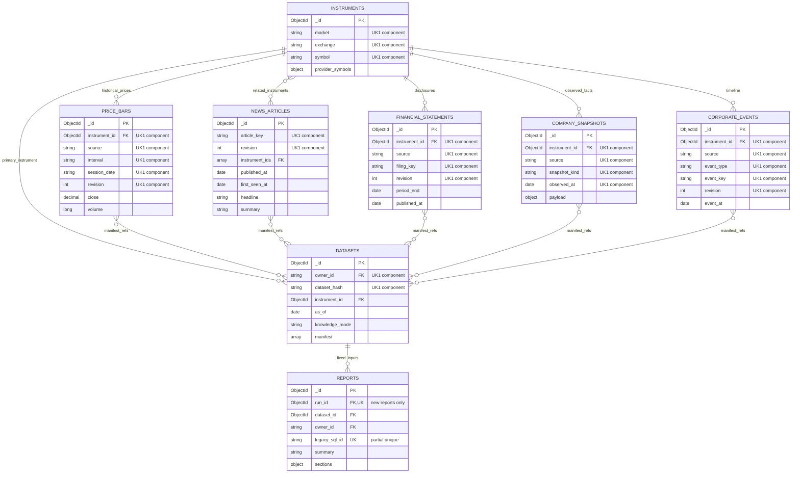
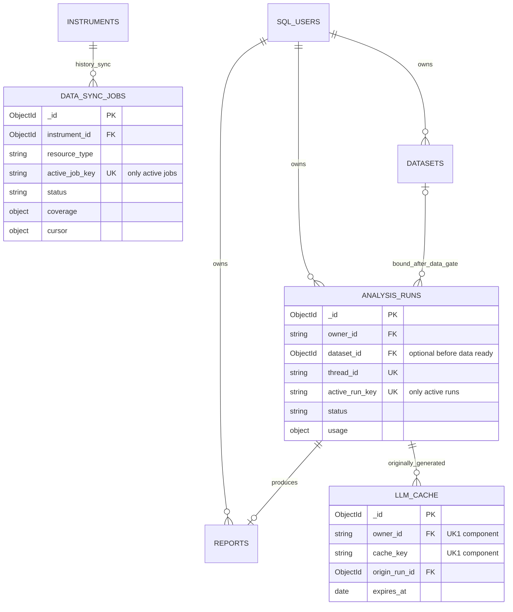

# MongoDB 市场数据与研究报告设计 v2.2

> 2026-10-24 用户修订（优先于下文旧基线）：MongoDB 是可选的优先缓存和历史存储。命中且未过期时读 MongoDB；无记录、缺覆盖、未配置或连接故障时由统一数据层回退 Yahoo/Finnhub 在线数据，分析可继续。在线回退保留来源、观察时间和持久化状态；实时 quote 不能替代历史 K 线，当前基本面不能冒充历史。存储失败须报告未保存，不能声称历史写入成功。

状态：建库评审设计稿，2026-10-24；尚未连接 MongoDB、建集合或迁移数据。需求以 [确认需求](../requirements/market-data-and-analyze.md) 为准。

交付组成：[完整全字段 ERD](mongodb-full-erd.md) 提供统一关系图和唯一键；本页说明数据模型和生命周期；[字段字典](mongodb-data-dictionary.md) 列出每个字段的 BSON 类型/必填性/索引；[物理定义 JSON](mongodb-schema.json) 包含严格顶层 validator、唯一索引和应用层引用规则。目标为 MongoDB 8.0+ replica set，实际 server/driver/checkpointer 版本需在实现时锁定。

## 1. 设计边界与纠正

- Finnhub 负责日内实时报价，应用按 source timestamp 显示新鲜度；第一版只做短期进程缓存，**不建立 MongoDB quote/tick 集合，不把报价采样拼成历史 K 线**。
- Yahoo 负责历史日线的外部获取；同步服务写入 MongoDB，分析和回测只读数据库。
- Finnhub 提供其免费账户实际获准的公司新闻、基础资料和事件。Yahoo 提供可用财报及分析师资料；不承诺免费源等价覆盖付费数据。
- 新闻、财报、快照、事件必须独立存储，不能全部压进报告或一个任意 payload 集合。分析引用它们的确定版本。
- 用户/鉴权/key/watchlist/交易记录继续在 SQL；Mongo 的 owner_id 是 SQL user id 的字符串表示，没有跨库外键或自动级联。
- MongoDB 保存数据只能减少重复外部请求；只有报告/节点复用以及压缩模型输入才减少 token。
- 公共市场事实跨用户共享；dataset/run/report/cache 按 owner 隔离。不会因为采用同一股票就共享用户持仓、预算或报告。

## 2. 业务 ERD

以下 FK 均为应用层逻辑引用。复合 UK 在命名索引表中定义，图中 `UKn` 表示同组字段共同唯一（instruments 的 UK 仅 active=true 生效），**不表示字段各自唯一**。修订文档的 `_id` 标识一个确定版本；article_key 等标识跨版本业务对象。

manifest 引用具体文档版本，不是数据库外键 join 表。datasets 的 instrument_id 是主标的，manifest 同时允许 SPY/板块等基准标的输入。迁移旧报告可无 dataset/run，故旧记录不受图中新报告的强制引用规则约束。

## 3. 运维与执行 ERD

### analysis_runs 到底做什么

它是一张**分析任务单**，不是行情，也不是报告正文。示例：用户请求分析 AAPL → 创建 run → 数据不足时 waiting_data → LangGraph running → 某个节点失败/恢复 → 生成 report；run 记录状态、图线程、模型/提示词版本、token 与费用。

为什么不只存 reports：失败任务也要可见，正在运行时尚无报告；恢复执行要找到 thread_id，重复请求需要合并，模型用量也要可归因。任务完成后，report 保存内容，run 保存执行轨迹。v1 不增加独立 run_steps 集合，详细节点状态交给兼容版本的 LangGraph checkpointer。

run_key 是输入指纹而非历史唯一键，允许用户强制重跑。只有 active_run_key 条件唯一，防止相同输入同时运行。它必须包括 owner，终态原子 unset；数据准备期间使用请求级 fingerprint，固定 dataset 后再绑定最终 run_key。phase 转换必须处理并发合并，不能在 dataset_id 未知时伪造其 hash。

### data_sync_jobs 到底做什么

它是**后台同步账本**。例如：AAPL 最近两年日线少了三天，只补三天；新闻下载到第二页失败，从断点重试。记录来源、范围、分页游标、完成情况、失败原因和租约，用于节流、去重和恢复。用户无需手动创建这些记录。

它同步的是历史日线、新闻、财报、资料和事件，不处理 Finnhub 实时报价。价格缺口按交易日历计算；新闻“某天零条”可能正常，覆盖应按“时间窗口/分页请求已成功完成”判断，不能把没有新闻当下载失败。

## 4. 业务唯一键、引用和查询设计

所有 collection 的 PK 均为 `_id:ObjectId`。业务 UK 独立于 PK，名称与字段顺序以 [物理定义](mongodb-schema.json) 为准：

| 集合 | 业务 UK / 条件 UK | 主要读取 |
|---|---|---|
| instruments | active=true 时 market + exchange + symbol | 代码解析为永久 instrument_id |
| price_bars | instrument + source + interval + session_date + revision | 标的日线范围，各逻辑 bar 最新 revision |
| news_articles | article_key + revision | 标的、发布时间范围，文章最新可用版本 |
| financial_statements | instrument + source + filing_key + revision | 年/季财报、披露时点、重述版本 |
| company_snapshots | instrument + source + kind + observed_at | 给定观察截止时最近快照 |
| corporate_events | instrument + source + type + event_key + revision | 事件时间线、当时已知的计划/取消 |
| datasets | owner + dataset_hash | 完全相同输入的固定快照 |
| analysis_runs | thread_id；存在 active_run_key 时唯一 | 用户任务列表、去重、恢复 |
| reports | 有 run_id 时唯一；有 legacy_sql_id 时唯一 | 用户历史报告、查看详情 |
| llm_cache | owner + cache_key | 节点结果复用 |
| data_sync_jobs | 存在 active_job_key 时唯一 | 任务合并、worker 提取与断点恢复 |

- 同名代码/代码复用：只有 active=true 的 market+exchange+symbol 条件唯一。退市旧 instrument 置 inactive 保留，新公司获得新 instrument_id；改名保留 symbol_history 的有效起止区间。按历史代码查询必须结合有效区间，应用检查区间不重叠；不能只按今天的 symbol 反查旧公司。
- article_key 以 provider + provider_article_id 为首选，缺 ID 才用规范 URL。不同供应商转载可保留多条，content_hash 辅助识别相同证据，避免 LLM 重复计算“多来源支持”。
- source 是采集供应商，publisher 是媒体；不可混用。多标的文章只存一份版本，instrument_ids 去重，查询索引只有一个数组字段。
- 缺失 optional 字段省略，不用 null；partial UK 避免迁移或准备状态记录互相冲突。
- 不用每字段建索引。范围查询与排序先验证 explain；全文向量检索、分片、分钟 K、大规模 tick 均不在 v1 基线。

## 5. 时间、版本与可追溯性

`event_at/bar_time/period_end` 是事实所属时间；`published_at` 是信息发布；`first_seen_at/observed_at` 是系统真正观察到；`fetched_at` 是网络抓取；UTC BSON Date 与交易所 session_date 分别保留。财报 period_end 不等于披露时间，未来财报日历也不等于未来信息已发生。

- history revisions 不覆盖：相同内容 hash 幂等，无变化不追加；变化时新增 revision。租约 + 唯一索引冲突重读保证并发写入不重复，供应商修订须回补/对账。
- 数据集固定 document_id、content_hash（以及其文档中的 revision），保存模型实际使用的 features、新闻摘要及证据引用。不是保存“查最近 100 天”就能重放。
- manifest 与 manifest_file_id 恰有一项；大清单入 GridFS 并记录内容 hash；报告引用的版本不得自动删除。
- knowledge_mode='historical_pit'：既要满足发布/事件语义，也要满足系统可得时间，缺少可靠披露时间不参与严格 PIT 推断；晚抓取数据不得假装历史已拥有。
- retrospective 可使用后来抓取的历史价格研究，但明确不同于严格历史可得性回测。live_observed 按当前已观察数据分析。
- current company metrics 只在 company_snapshots 存真实观察时间，不把请求日期写成历史事实；TTM 是季度财报四季聚合的计算结果与版本，不当作年度源财报保存。

## 6. 嵌入对象 subtype 契约

Mongo validator 在物理 JSON 中校验顶层类型、枚举、必填、价格关系、标准财报字段类型、manifest 二选一和报告来源的条件必填；以下对象语义还必须用领域模型验证。它们不是允许随意存任意 payload 的理由，实施时应把稳定子字段下沉至 BSON validator。

| 对象 | 定义 |
|---|---|
| financial income_statement | revenue/gross_profit/operating_income/net_income/eps；金额 Decimal128，eps 每股口径，缺失省略 |
| balance_sheet | total_assets/total_liabilities/equity/cash/total_debt/shares_outstanding；金额 Decimal128，股数独立单位 |
| cash_flow | operating_cash_flow/capital_expenditure/free_cash_flow/dividends_paid；币种与单位一致，符号按规范化约定 |
| company profile payload | name/sector/industry/exchange/currency；缺字段记录 quality，不凭模型填充 |
| company metrics payload | pe/pb/market_cap/roe/gross_margin 等标准指标及各自单位；比例为小数，数值包含来源时间 |
| analyst_targets payload | median/mean/high/low/n_analysts/currency；不可据当前快照编造历史评级 |
| earnings_calendar event | fiscal_period、expected_report_at、confirmed；事件状态允许取消/修订 |
| earnings_result event | fiscal_period、actual_eps、estimated_eps、surprise；区分实际披露时间 |
| insider_trade event | source transaction ID、人名/角色、transaction_date、filing_date、shares、price、transaction_code；缺正式 ID 时按规范字段生成 event_key |
| analyst_rating event | firm、old/new grade、action、source event time |
| dividend/split event | ex_date/pay_date、amount/currency 或 ratio；与 bar 分红/拆股字段对账，不重复计入收益 |
| report sections | 有界章节名→{status, markdown, structured, persona_used, evidence_refs, skip_reason}；失败/跳过明确，不存无限历史数组 |
| report artifacts | [{file_id, mime, bytes, sha256, renderer_version}]；检查 GridFS 存在性和归属 |
| versions / usage | graph/prompt/model/provider/schema/features 版本；实际 input/output/cache tokens、请求计数、币种与已知费用，费用未知保持 unknown |

新闻全文不是免费新闻 API 的默认能力。默认只保存原接口返回的标题、摘要、URL和元数据；不自动爬全文。已有合法全文来源再保存 GridFS，并设置 content_policy='licensed_fulltext'。摘要缺失不能用生成文字冒充原文摘要。

## 7. 新闻覆盖与生命周期

Finnhub 官方 company-news 的免费标记为 “1 year of historical news and new updates”，并说明端点面向北美公司。**这是可请求窗口，不代表系统现在已拥有一年数据，也不能推导可免费回补任意多年新闻。**

同步窗口滚动抓取、有重叠以捕获迟到/修订，分页游标与成功窗口记在 data_sync_jobs。无权限、限流、供应商无更老数据分别记录，不无限重试。不预先执行全市场新闻爬取。

| 数据 | v1 保留/清理 |
|---|---|
| bar / financial / event / snapshot / news | 默认持久保存所采集的版本；被报告引用的记录不得删除。后续按容量/授权规则配置保留策略 |
| datasets / reports | 默认不自动过期；删除账户按 owner 清理私有记录，公共市场数据不随之删除 |
| analysis_runs | 先保留执行与费用元数据；详细日志不嵌入，策略确认后单独清理 |
| llm_cache | 配置 TTL；应用先检查 expires_at，数据库 TTL 不保证即时删除 |
| sync jobs | 保留有效 coverage/游标；旧执行日志可压缩，但不能删掉覆盖事实后反复下载 |
| Finnhub 实时报价 | 仅短期进程缓存；重启丢失是允许的，不用 MongoDB 充当逐笔归档 |

容量评估按选定 universe、回填年数、新闻密度、平均文档/索引大小计算，不能仅按 JSON 原文大小估算。v1 只补实际分析所需标的和时间范围，确认预算后再扩大。

## 8. 一致性、权限与缓存

1. 新 reports(provenance=native) 必有 run_id/dataset_id；legacy_unverified 必有 legacy_sql_id，允许无 run/dataset。应用检查三者 owner_id 和 instrument_id 一致，不伪造旧报告数据快照。
2. references 校验在写入路径完成；MongoDB 不提供跨集合 FK，更没有 SQL↔Mongo 事务。用户删除采用幂等删除任务/outbox 与重试，不靠数据库级联。
3. run 成功/partial 输出可存 report；失败不生成假成功 report。直接复用旧报告时新 run 写 cached_from_report_id，返回已存在报告，不复制并假称重新分析。
4. checkpoint 使用已锁定版本的 MongoDB LangGraph 插件独立集合，不自定义其内部 schema。API key 不进 checkpoint、dataset、report、cache。
5. final report 用 partial unique(run_id) 幂等保存；同 Mongo replica set 内需要多文档原子一致性时用事务；GridFS 与跨库动作使用状态机/补偿。不能承诺网络模型调用 exactly-once 计费。
6. cache_key 覆盖 owner、节点实际输入、上游输出 hash、模型/provider/参数、语言、prompt/schema 版本。dataset_hash 覆盖全部源文档版本及 features 计算版本。跨用户不复用私有结果。
7. 报告读取必须 owner 过滤。公开数据查询与私有文档访问在 Repository 层分离；checkpoint thread_id 不能由用户任意指定。
8. 价格、财报、新闻与事件使用实体字段查询；给 LLM 的是筛选后的证据和指标，不是全库文本。缓存命中/未命中分别计量，数据落库不等于 token 自动降低。

## 9. 读取接口与落地顺序

Repository 分为 HistoricalPrice、News、FinancialStatement、CompanySnapshot、CorporateEvent、Dataset、AnalysisRun、Report、ModelCache；同步 worker 为单独服务。分析节点不直接 import Yahoo/Finnhub 网络 client。

- Finnhub quote：RealtimeQuoteService → Finnhub → 进程缓存/UI；需要作为研究依据时，将本次选取的值和源时间封入 dataset.features evidence，而非持续归档 tick。
- 历史证据：Request → coverage gate → 同步缺口/等待 → Repository 查询 → 冻结 dataset → LangGraph → report。
- 新闻查询：instrument + [published_start,published_end) + knowledge cutoff，先过滤可用版本，再选择 article_key 最新 revision；不能先取最新修订再把未来修改后的内容带入历史报告。
- 旧 SQL 报告：按 legacy_sql_id 幂等迁入，保存原 owner/内容/时间，验证数量与样例后再切读；不提前删 SQL 表。

建库前验收：严格 validator/条件 UK 在目标 Mongo 运行通过；同名与多标的文章去重；版本修订/迟到消息；新闻窗口与无数据；跨用户权限；report/run/dataset 条件引用；修订行情下旧报告可追溯；active key 释放和崩溃恢复；TTL 过期但尚未清理仍不命中；费用未知状态与强制重跑。JSON 校验和文档一致性检查不能替代真实数据库验证。

## 官方依据

- [MongoDB unique/partial indexes](https://www.mongodb.com/docs/manual/core/index-partial/)：部分唯一约束只约束满足过滤条件的文档。
- [MongoDB JSON Schema](https://www.mongodb.com/docs/manual/core/schema-validation/specify-json-schema/)：结构校验；跨文档引用与业务语义仍需应用校验。
- [MongoDB time-series 限制](https://www.mongodb.com/docs/manual/core/timeseries/timeseries-limitations/)：v1 为唯一约束/修订采用普通集合。
- [MongoDB 文档大小](https://www.mongodb.com/docs/manual/core/document/)：BSON 16 MiB；大型正文/清单使用 GridFS 并控制应用大小。
- [Finnhub Company News](https://finnhub.io/docs/api/company-news)：2026-10-24 核对官方内嵌 schema，freeTier='1 year of historical news and new updates'，description 指定北美公司；未使用账户 key 实测。

## 10. 每日扫描历史（v2.2 补充，必须实现）

每日扫描既产生市场证据，也产生扫描结果，两者都进入 MongoDB：Yahoo 日线/公司资料/新闻等按自身集合入库并去重；扫描批次和全量标的结果分别写 scan_runs、scan_results。**不是仅持久化报告或最终 Top N，也不是把实时 tick 全部存库。**

### scan_runs 与 scan_results

- scan_runs：owner、SQL config_id、当次完整 config_snapshot、实际 universe 清单/hash、交易日/时区、as_of、算法/权重版本、运行状态和计数。execution_key 唯一；同一调度槽重试续跑同批次，主动重扫创建新键，不能按 scan_date 单列唯一。
- scan_results：每个 run+instrument 唯一。保存 selected/rank、可用的各项分数、方向、每个启用 detector 的状态/严重度/组件/原因和输入 dataset_id。`evaluated` 可以没有触发事件；`no_data`/`error` 不伪造零分成功。
- detector_results 是有界内嵌数组；同一 detector 只出现一次，由应用验证。保留 no_event/no_data/error/retired，不能只留 triggered 事件。
- SQL ScannerConfig 可继续管理配置，但历史批次必须冻结配置内容；以后修改权重不改变过去的扫描解释。
- 正常完成需对照 universe 清单确认每个标的有明确 outcome；部分失败状态 partial 并标明覆盖情况。批次早期整体失败不伪造全标的完成。
- 写入可分块、幂等；running 批次结果视为未发布，成功/partial 终态作为发布屏障。终态结果不可原地覆盖；恢复失败批次必须保留尝试记录并避免把旧 worker 的迟到结果写入新版本。
- 新 evaluated 结果必须关联固定 dataset，里面包含当次 bar/新闻/财报/事件的确定版本；缺数据/失败可省略 dataset，但记录 quality。后续 Analyze 有 source_scan_result_id，仍固定自己的 as_of/dataset，不能默默把更新数据冒充扫描当天输入。
- scan_results 持有 owner 冗余字段用于权限索引，应用验证与 run 一致；用户只能查看自己或被明确授权共享的历史。

### 保留与旧 SQL 迁移

scan_runs/scan_results 第一版不设 TTL，不每天覆盖一份最新结果。按 owner+日期查询批次，再按 instrument 查历次评分和触发变化；只取 selected=true 即得到当日候选列表。

旧 SQL scan_runs/watchlist_entries 只保存了批次和排名结果，不具备完整 universe 的每个 outcome。迁移用 coverage_mode='legacy_topn_only'、legacy_sql_id 幂等，不能伪造缺失的未入选标的或历史 dataset。新批次 coverage_mode='full_universe'。旧 config 无法重建时保存 available legacy 配置与缺失标记，不用当前配置冒充旧配置。

新增验收：同天多次扫描都可追溯；调度重试不重复；未入选/缺数据/失败各自可查询；扫描配置改动不影响旧结果；数据库写入失败不把批次标为成功；旧 Top N 迁移明确不完整；实时 quote 仍由 Finnhub 即时提供，不引入 tick 归档。
