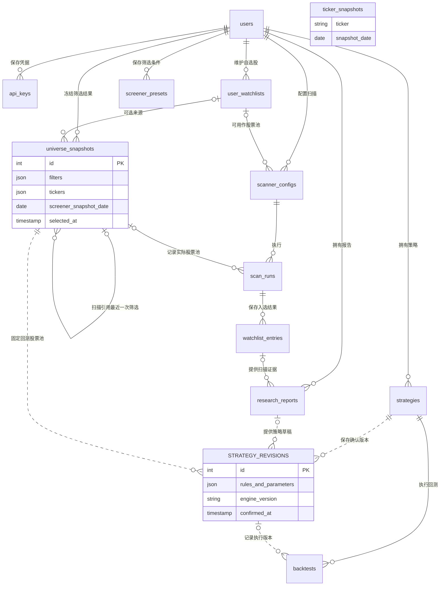
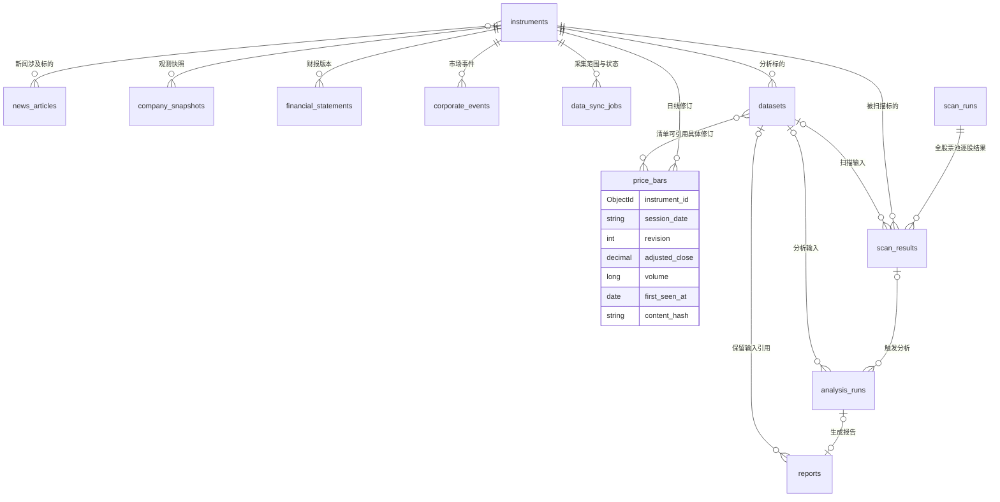

# Market Scanner 研究闭环 ERD

## PostgreSQL · 业务与来源

实线标记已落地的核心外键，虚线标记后续策略版本和回测关联。图中省略通知、调度和 Paper 等外围模块。

Screener 按交易日读取 ticker_snapshots，表中 ticker 与 snapshot_date 联合唯一。一次筛选可以选中多行，因此股票池快照复制实际选中的代码、日期和条件。现有 watchlist_entries 存储扫描排名结果，与用户手动维护的 user_watchlists 含义不同。新闭环运行必须保存来源；旧运行和独立创建的报告可以缺少相应关联。新运行在 scan_runs.outcomes 保存逐股状态和检测器证据，在 detector_config 保存当次生效的配置与版本。

## MongoDB · 行情、扫描历史与分析证据

以下是仓库 Mongo schema 中的主要集合与应用层文档引用。每个集合的主键是 _id。清单按集合名和文档 ID 指向实际输入版本。

同一标的、来源、周期、交易日和修订号共同标识一个日线版本。报告所用行情以具体版本为准。Mongo 中的 scan_runs 和 reports 是历史档案，PostgreSQL 中的同类记录承载用户操作和导航。

拟新增的跨库关系由应用维护。PostgreSQL 回测记录保存 Mongo 冻结数据集的 ID、哈希与完整性状态。当前 datasets 以单一标的为中心，全股票池回测还需要组合级清单，覆盖实际股票列表、预热期、SPY、公司行动和各输入版本。只有原始输入完整且可读时才提供原数据重放。

依据：[SQLAlchemy 模型](../../app/backend/database/models.py) · [MongoDB schema](mongodb-schema.json) · [闭环设计](../superpowers/specs/2026-11-17-history-research-loop-design.md)
