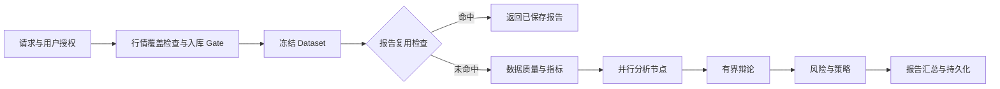

# Market Scanner 新需求基线

> 2026-10-24 用户修订（优先于下文旧基线）：MongoDB 是可选的优先缓存和历史存储。命中且未过期时读 MongoDB；无记录、缺覆盖、未配置或连接故障时由统一数据层回退 Yahoo/Finnhub 在线数据，分析可继续。在线回退保留来源、观察时间和持久化状态；实时 quote 不能替代历史 K 线，当前基本面不能冒充历史。存储失败须报告未保存，不能声称历史写入成功。

状态：核心数据/扫描/Analyze 链路已进入本地验收；生产数据库和真实模型验收尚未完成。更新：2026-10-24。

## 已确认决策

1. 行情采用免费来源：Finnhub 实时报价 + Yahoo Finance 历史行情。历史行情先入 MongoDB，分析和回测从 MongoDB 读取。
2. 删除 EODHD 的实现、公开导出、工厂分支、配置/密钥入口、付费 tier 徽标及相关专属测试。Financial Datasets 不再作为新分析的必要依赖；其旧可选入口的最终删除放在独立兼容迁移中，不能混同 EODHD 已授权删除。
3. 新 Analyze 报告必须以 LangGraph 编排，为主分析入口。复用旧投资分析的有效计算和 agent，逐步下线重复的旧入口；不得在新图之外保留另一套隐式分析主线。
4. 模型允许用户自带 API key，也保留 Ollama；“免费”指行情不要求付费订阅，不表示模型、MongoDB 托管或服务器零成本。
5. 普通用户、后台任务、定时运行均不得静默使用服务器的付费模型密钥。用户无可用模型时提供明确配置错误。Owner 本人也通过显式配置选择模型，不依靠隐式 fallback。
6. 历史分析报告保存到 MongoDB，支持用户隔离、历史查看、完全匹配复用与强制重新分析。
7. 仓库中的旧计划、历史设计和实测笔记删除；部署/迁移说明、运行时提示词、代码测试和有效工程约束保留。

用户后续授权：旧 LangGraph Analyze 已删除，旧 Pipeline 执行退役；有效 agent 保留供新 Analyze 迁移复用。

## 当前实现与目标的差距

| 范围 | 当前 | 目标 |
|---|---|---|
| 行情 | MongoDB 优先，Yahoo/Finnhub 在线回退；FD 显式兼容 | 完成真实数据库和源权限验收 |
| Yahoo | 日线、原始/复权/公司行动分离，历史版本入库 | 扩展独立后台缺口同步、租约和修订验收 |
| Analyze | LangGraph 章节图、checkpoint 和有界辩论 | 完成真实模型及恢复验收 |
| Debate | 独立发言/反驳/裁决节点，轮数有界 | 完成真实模型质量验收 |
| 报告 | 可选 MongoDB 报告与 SQL 兼容副本，迁移工具已准备 | 在测试数据库验证迁移/回滚 |
| 缓存 | 进程内局部缓存 | 行情持久化、数据集快照、报告/节点结果复用 |

本表描述的是未完成的改造，不能将目标写成当前线上能力。

## 行情与 MongoDB 要求

### MD-01 历史读取与入库分离

- 统一数据层优先读取有效 MongoDB 缓存；缺少覆盖、未配置或数据库故障时允许在线抓取 Yahoo/Finnhub，分析节点通过同一数据层获取证据，并记录在线回退和持久化状态。
- 请求范围按交易日历检查，按缺口增量补齐；请求去重/租约避免同一范围并发重复调用。
- 内部查询统一 [start,end)，旧接口包含式 end_date 在适配边界转换。
- 同名代码按市场/交易所隔离，统一 UTC 时间和交易所 session_date。
- 原始 OHLC、复权价、分红/拆股分开；修订保留版本，使旧报告可追溯。
- 当前财务快照不得冒充过去可得的基本面，TTM 不得用年度财报假充。

### MD-02 实时报价与能力降级

- Finnhub 负责日内实时报价：应用保留源时间与接收时间，使用短期内存缓存，v1 不建立 MongoDB quote/tick 集合，不由历史入库任务处理实时流，也不从零散 quote 合成“官方历史 K 线”。
- 不依赖 Finnhub Candle 作为免费历史行情来源。2026-10-24 已核对 [Finnhub 官方文档](https://finnhub.io/docs/api/stock-candles) 内嵌 window.docSchema：/stock/candle 的 get.premium 为 `Premium Access Required`、freeTier 为 null。这是官方套餐标记核验，未使用用户 key 调用验证。
- 403/429/无数据需要可识别状态，不能一律显示为“未发现机会”。新闻/内部人等按实际免费权限验证，缺失明确标注。
- 移除 EODHD 后，现有 A 股适配层不得因美股数据源更换被误删。

### MD-03 存储和迁移

集合、字段、索引及接口以 [MongoDB ERD v2](../design/mongodb-market-data-erd.md)、[字段字典](../design/mongodb-data-dictionary.md) 和 [物理定义](../design/mongodb-schema.json) 为准。历史证据必须覆盖新闻、财报、公司/分析师快照与公司事件，而不只有 K 线。新闻同步受供应商窗口限制，明确发布时间、首次观察时间、去重与修订版本；默认保存 API 返回标题/摘要/元数据，不默认抓取全文。analysis_runs 是执行/费用记录，data_sync_jobs 是历史证据同步账本，两者均不负责实时价格。

现有 SQL 继续管理账户、密钥、权限、watchlist、调度和交易记录。历史报告按 legacy_sql_id 幂等迁入，保留 owner、原时间、输入、章节、HTML/Markdown、策略及回测。迁移后校验数量/抽样内容并保留回滚窗口；不提前删除 SQL 表或旧报告。

### MD-04 每日扫描历史必须入 MongoDB

- 每次每日调度扫描和手动扫描保存 scan_runs 批次，以及实际 universe 内每个标的的 scan_results，不只保存 Top N。
- 保留当次配置、交易日/as_of、universe、算法版本、分数/方向/排名、每个 detector 的触发或未触发/缺数据/错误状态，以及输入证据版本。
- Yahoo 日线、新闻、财报和其他扫描输入进入各自历史集合，去重并保留修订；不能仅存派生分数就宣称原始历史可重放。
- 同日多次主动扫描有独立历史；同一调度任务重试幂等，数据库写入失败不能误报成功。
- 旧 SQL 扫描结果可迁移，但旧库仅有 Top N 的批次须标 legacy_topn_only，不补造完整历史。
- 扫描触发分析通过 source_scan_result_id 关联；Finnhub 实时价格保持外部服务/短期内存缓存，不属于扫描历史 tick 归档。

## Analyze LangGraph 要求

### AG-01 图的最小结构

- 保留 sections 选择、personas/override、辩论轮数、语言、风险偏好及用户持仓输入的现有能力。
- agent 只返回自己的局部状态更新；嵌套信号用明确 reducer 合并，禁止依赖共享字典原地修改。
- 独立分析节点可以并行；汇总节点等待全部必要依赖完成。可选节点失败进入缺失标记，必要数据失败不得生成假成功报告。
- checkpoint/重试与外部副作用幂等；已保存的成功节点恢复时不重复请求，最终报告按 run_id 去重。模型请求超时但服务商可能已计费时记录 unknown 状态，禁止承诺跨供应商 exactly-once 计费或无界重试。
- 复用旧 agent 前清除隐式 FD key 依赖及主机模型 fallback；旧 API 在迁移期给明确 deprecation/owner gate，不静默改变历史调用语义。

### AG-02 模型、权限与缓存

- 每次执行固定 owner_id、run_id、dataset_id；API key 仅在运行时从受控密钥服务取得，不进入报告、日志或 checkpoint。
- BYOK 与 Ollama 均需有接通验收。Ollama 不可用时不得偷偷切换付费供应商。
- 报告复用键覆盖数据版本、请求、持仓、语言、graph/prompt/model/schema 版本；不以 ticker+日期当唯一依据。
- 节点缓存只复用结构有效的成功结果，按 owner 隔离；TTL 在应用查询时判断，失败占位不缓存。
- 模型输入以紧凑指标和必要证据为主，不默认传入多年 K 线或全部历史报告；记录 token、实际调用数、费用与缓存命中。
- force rerun 明确绕过报告和节点缓存；行情更新使新分析失效，但旧报告仍可查看。

## 实施顺序与完成标准

1. 数据契约、MongoDB 校验/索引、Repository 接口和隔离测试，包含 scan_runs/scan_results 的每日全量扫描历史。
2. Yahoo 入库与 MongoDB 历史读取；验证幂等、日期边界、交易日缺口、复权修订与无数据。
3. 切换 Composite 数据路由并删除 EODHD 全链路，Scanner/CLI/Analyze/Lab/回测同步验证。
4. Analyze 迁到 LangGraph，保留功能并验证并发 reducer、有界辩论、checkpoint 恢复、BYOK/Ollama 与费用隔离。
5. 报告迁移与报告/节点缓存，验证权限、版本失效、强制重跑、任务并发去重。
6. 下线重复旧入口及确认无消费者的旧事件类/空壳；最后部署验收。

最终验收必须同时覆盖：无 EODHD key/调用/入口；有效缓存命中时不重复抓取 Yahoo，缓存未命中时按需在线回退；普通用户不会消耗主机模型 key；缺行情不冒充无机会；旧报告仍可读；可追溯输入版本；模拟故障和至少一次真实免费源小范围 smoke。

## 实现时可配置的默认值（不是待用户批准的阻塞项）

- 第一阶段历史行情 1d，美股先验收；保留 A 股现有行为，分钟 K/逐笔不在本轮承诺范围。
- 仅为实际扫描/分析标的回填所需区间，不启动全市场多年回填；基准/板块标的也纳入数据快照。
- quote freshness、LLM TTL、入库调度、并发限额和回填年限可配置，首次接通真实源后再校准。
- MongoDB URI/数据库名通过服务端配置提供，不提交凭据；集合名由 ERD 明确。
- LangGraph/checkpointer 的具体兼容版本在实施时验证，当前依赖 0.2.56 不能直接假定支持最新存储插件。
